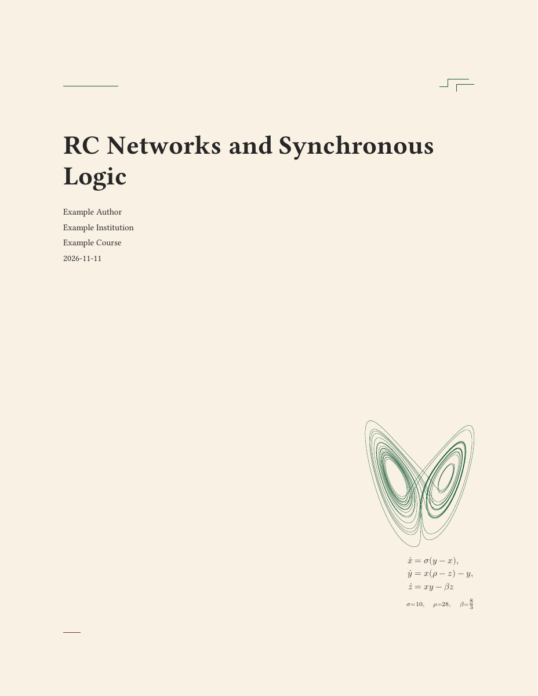
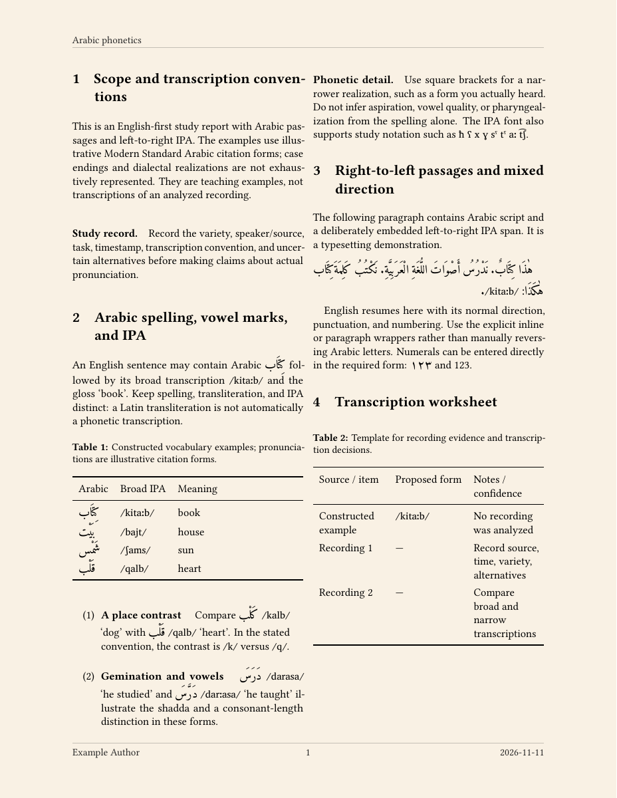

# ConTeX

ConTeX is a LuaLaTeX library for technical and language notes. 
Start with a single '.tex' file or choose a topic template for 
mathematics, engineering, programming, research, or language study.

## Previews

<table align="center">
  <tr>
    <th>Engineering cover</th>
    <th>Arabic and IPA body page</th>
  </tr>
  <tr>
    <td>
      <a href="previews/engineering.pdf">
        
      </a>
    </td>
    <td>
      <a href="previews/arabic.pdf">
        
      </a>
    </td>
  </tr>
</table>

Full PDFs: [Engineering](previews/engineering.pdf) ·
[Mathematics](previews/mathematics.pdf) ·
[Programming](previews/programming.pdf) ·
[Research](previews/research.pdf) ·
[Language](previews/language.pdf) ·
[Arabic](previews/arabic.pdf)

Use LuaLaTeX and latexmk from TeX Live or MacTeX, with BibTeX for bibliographies.
The fonts are Libertinus Serif, TeX Gyre Heros, Latin Modern Mono, and Latin Modern
Math. Language notes use Charis SIL for IPA and Amiri for Arabic.

The shared styles use fontspec, mathtools, amsthm, unicode-math, TikZ, tcolorbox,
and hyperref with cleveref. Optional modules add PGFPlots, CircuitikZ, tikz-timing,
siunitx, listings, algorithm and algpseudocode, natbib, and Babel.

## Quick start

Install LuaLaTeX and latexmk from TeX Live or MacTeX. See
[dependencies.txt](dependencies.txt) for the fonts and packages used by each profile.

```sh
mkdir -p "$HOME/Code"
git clone https://github.com/aidanlihenderson/ConTeX.git "$HOME/Code/ConTeX"
```

If you already have a checkout, use its location in the commands below.

### Try a single-file starter

From the directory where you want to keep your notes, copy the
[general starter](standalone/main.tex) into a new file:

```sh
cp -i "$HOME/Code/ConTeX/standalone/main.tex" "Quick Notes.tex"
latexmk -lualatex -outdir=build -halt-on-error "Quick Notes.tex"
```

Open `build/Quick Notes.pdf`. Edit the title fields in the preamble and write
your notes below `\maketitle` using any text editor. For Arabic and IPA, copy
the [Arabic starter](standalone/arabic.tex) instead and install its listed
language dependencies.

### Create a topic project with zsh and Neovim

Use a topic project when you want separate files for your notes, figures,
code, or references. The creation helper requires zsh and Neovim.

```zsh
export LATEX_LIBRARY="$HOME/Code/ConTeX"
source "$LATEX_LIBRARY/shell/latex.sh"
newtex e "Engineering Notes"
```

`newtex` creates the project under `LATEX_HOME` (default `$HOME/Desktop/Notes`),
copies the shared styles and data into the project's `tex/` directory, and opens
`main.tex` in Neovim. After exiting Neovim, run this from the project directory:

```sh
latexmk -halt-on-error main.tex
```

Open `build/main.pdf`. See the [profile table](#topics-and-environments) for
the other topic codes. For an Arabic project, use
`newtex l "Arabic Notes" --arabic`.

The same helper also provides `tex "Quick Notes"` and
`tex "Arabic Notes" --arabic` for creating or opening a single-file note in
the current directory.

## Write and build

Set the title fields in the project’s `main.tex` and write in
`sections/body.tex`. In a standalone file, write directly below `\maketitle`.

```latex
\title{Fourier Analysis}
\subtitle{Series and transforms}
\author{Example Author}
\date{2026-11-10}

\begin{document}
\maketitle
\input{sections/body}
\end{document}
```

Build a project with `latexmk -halt-on-error main.tex` or a standalone file with
`latexmk -lualatex -outdir=build -halt-on-error "Quick Notes.tex"`.

Add `\ConTeXBackgroundOff` in the preamble to omit the page background for
printing. Topic starters select their cover motif. Use
`\projectsetup{motif={none}}` to hide it or choose `engineering`, `programming`,
`phonetics`, `arabic`, `mathematics`, or `research`. General standalone notes
default to `none`, and Arabic standalone notes default to `arabic`.

## Topics and environments

| Profile | Available features with the relevant modules |
|---|---|
| Mathematics (`m`) | `theorem`, `lemma`, `corollary`, `proposition`, `definition`, `example`, `problem`, `remark`, `proof`, `solution` |
| Engineering (`e`) | `circuitikz`, `tikztimingtable`, SI units |
| Programming (`p`) | `lstlisting`, `algorithm`, `algorithmic` |
| Research (`r`) | `tikzpicture`, PGFPlots `axis`, BibTeX citations |
| Language (`l`) | `lingexample` and IPA commands |
| Arabic (`l --arabic`) | `arabicparagraph`, `lingexample`, inline Arabic and IPA |
| All profiles | `notebox` |

In projects, load `tex/core` first, any optional `tex/<name>` modules next, and
`tex/links` last.
